# Online Inventory Control System

### PHP & MySQL | Academic Project

An Online Inventory Control System developed as an academic project using PHP, MySQL, HTML, CSS, and JavaScript.

The system is designed to simplify inventory management, organize product records, monitor stock levels, and manage business operations through a user-friendly web interface.

## Technologies Used

- PHP – Backend Development
- MySQL – Database Management
- HTML5 – Page Structure
- CSS3 – Styling and Layout
- JavaScript – Frontend Functionality
- XAMPP – Local Development Environment

## Key Features

- User Login and Authentication
- Role-Based Access Control
- Admin Dashboard
- Product Management (Add, Update, Delete, View)
- Inventory and Stock Tracking
- Order Management
- Product Categorization
- Sales Reports
- Database Integration

## Project Screenshots

The following screenshots demonstrate the project's interface and functionality.

### Project Interface

### Additional Screenshots

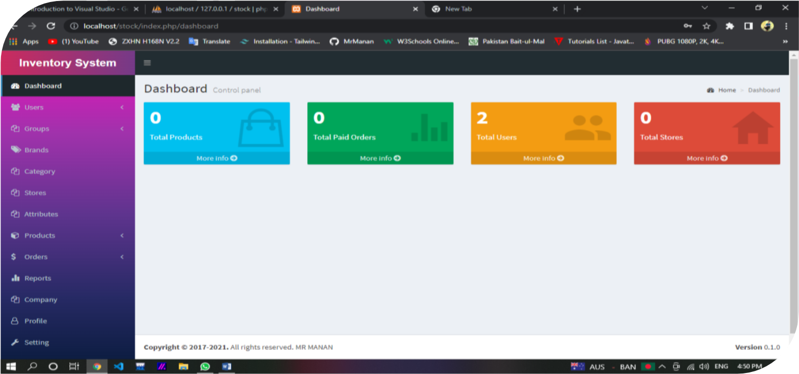
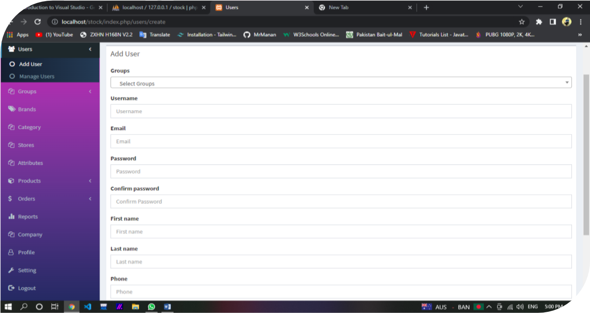
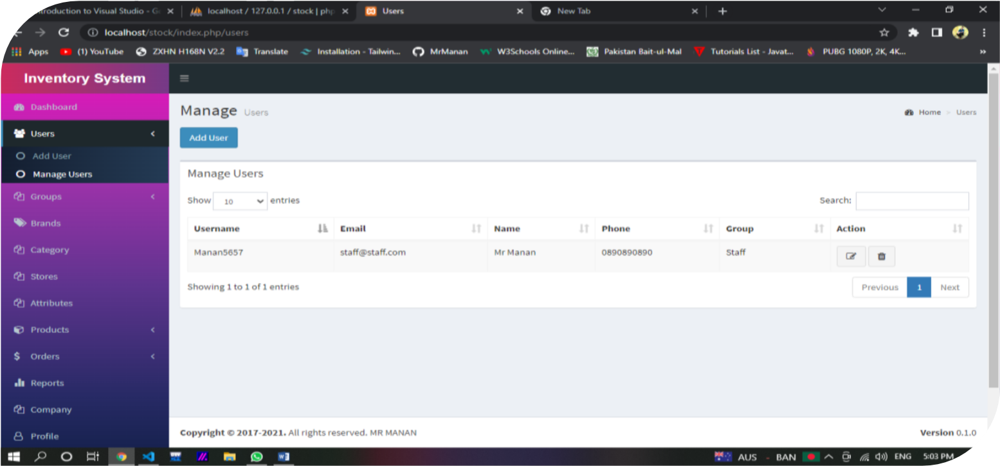
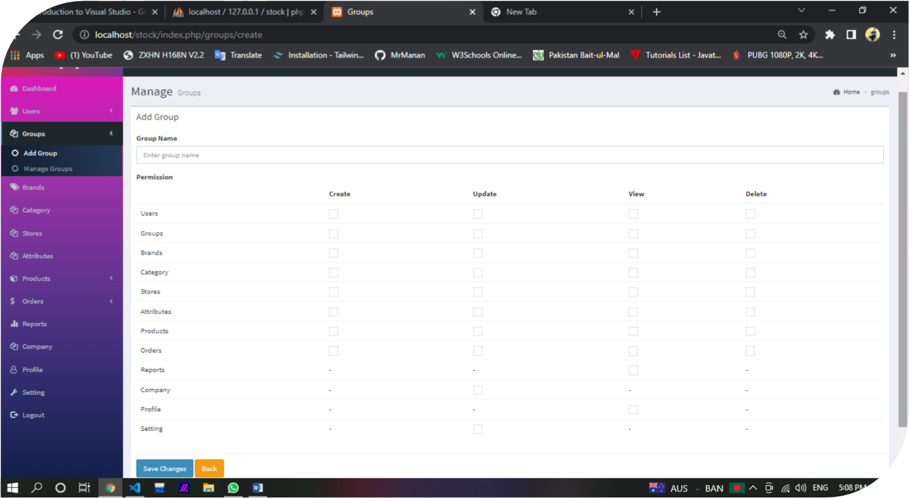
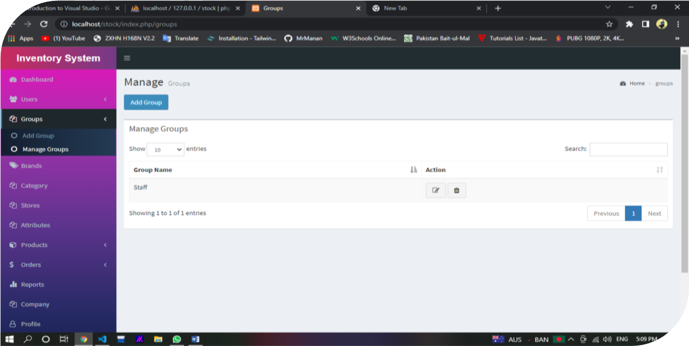
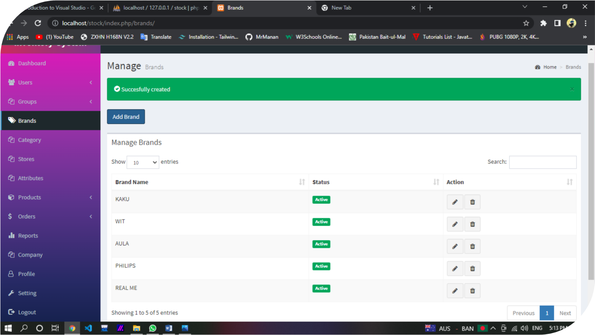
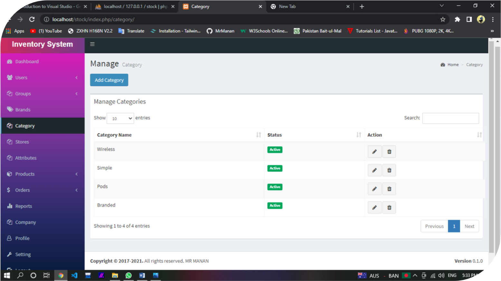
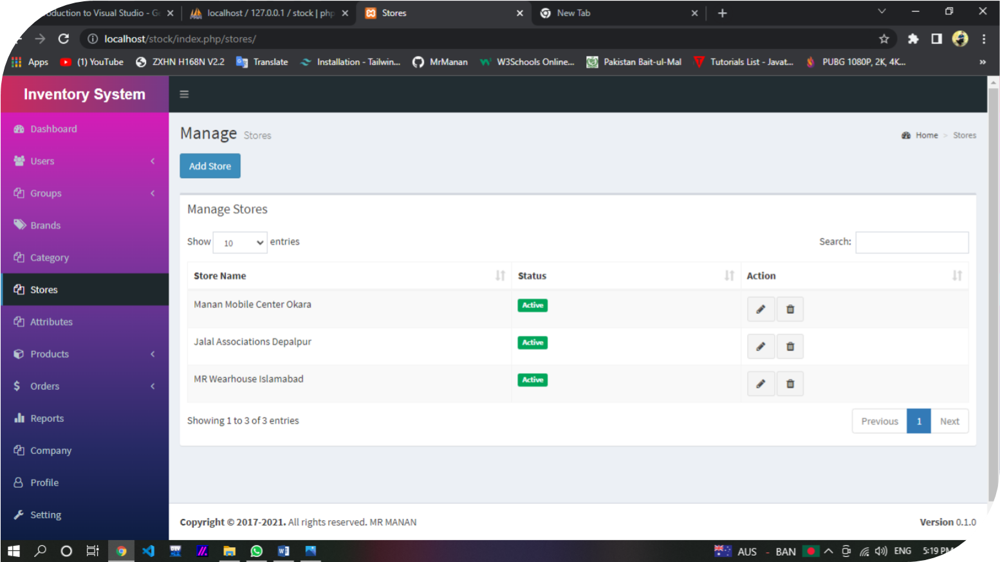
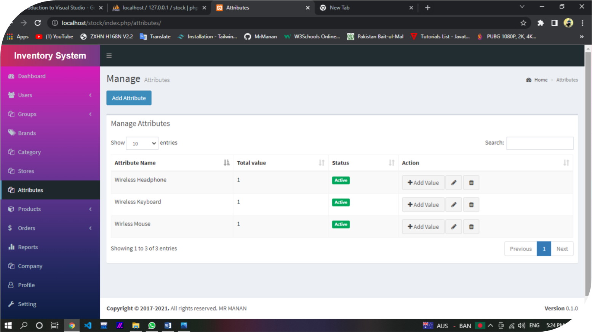
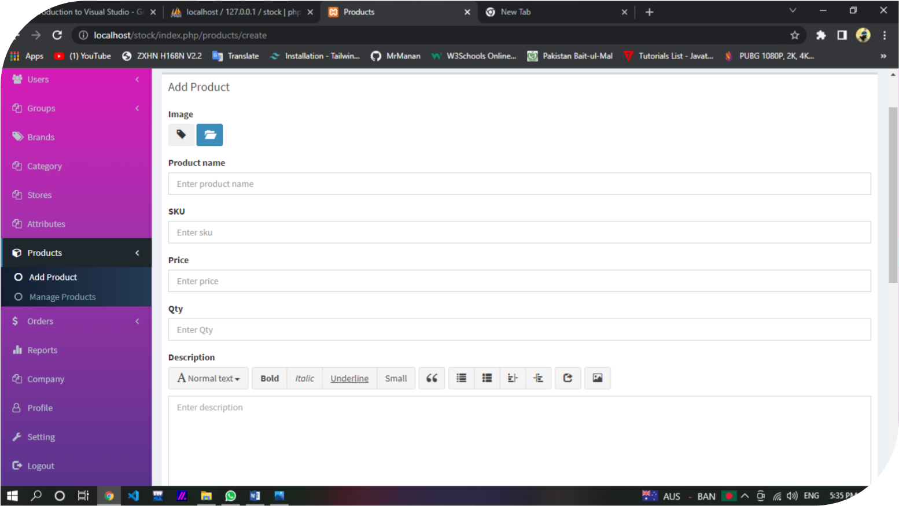
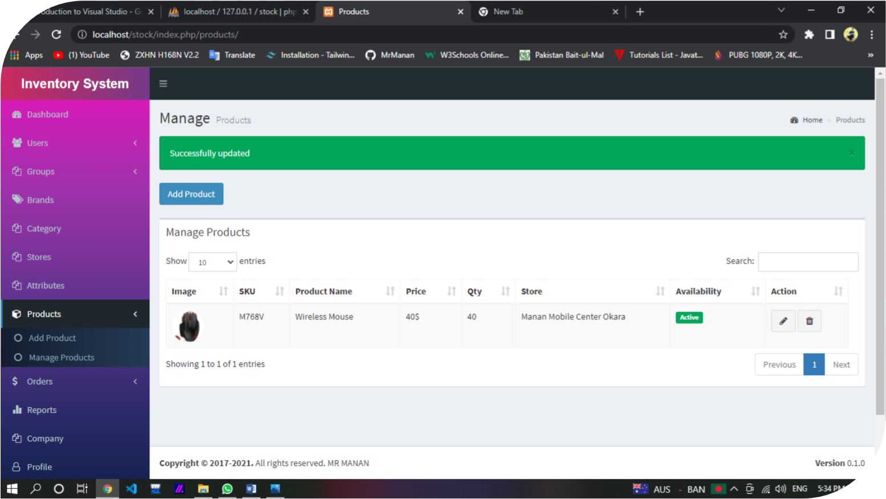
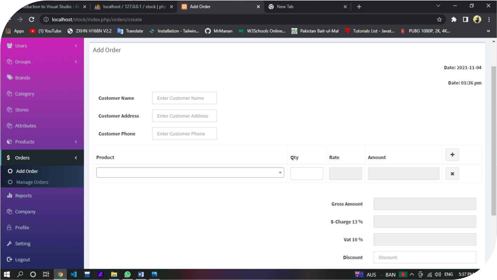
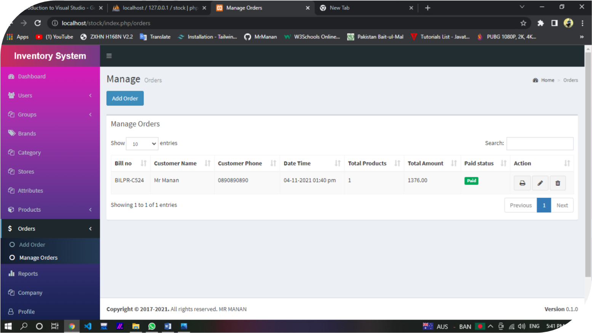
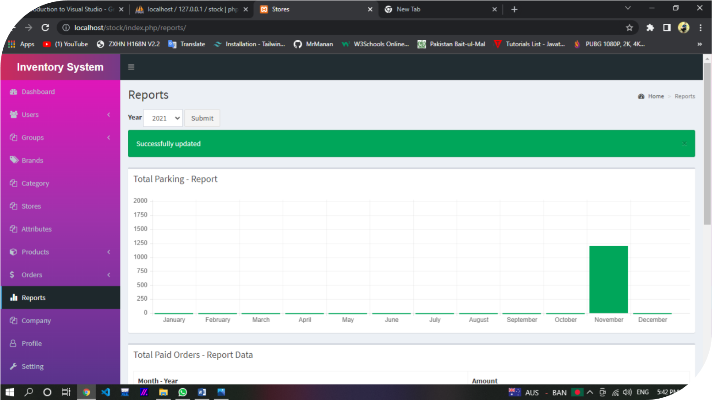
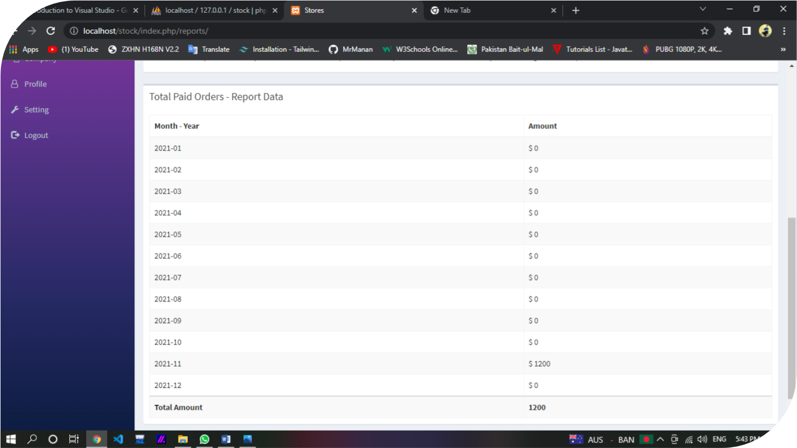
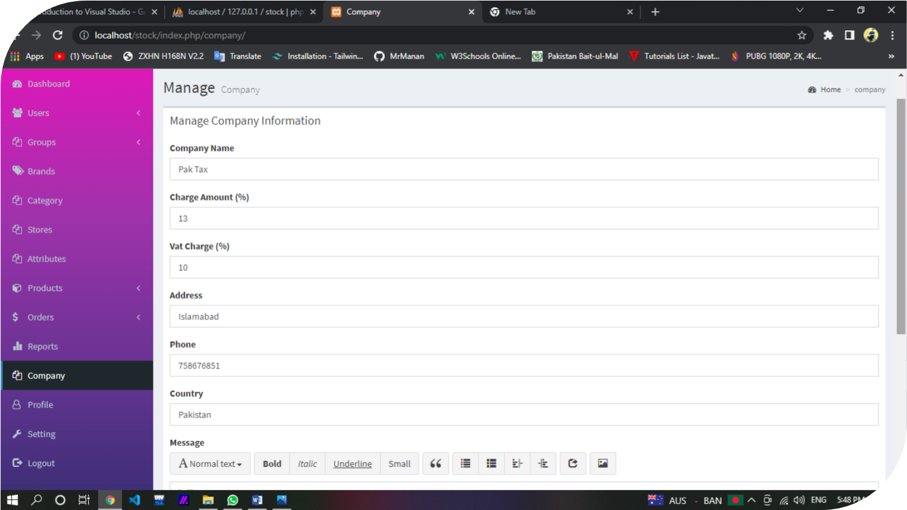
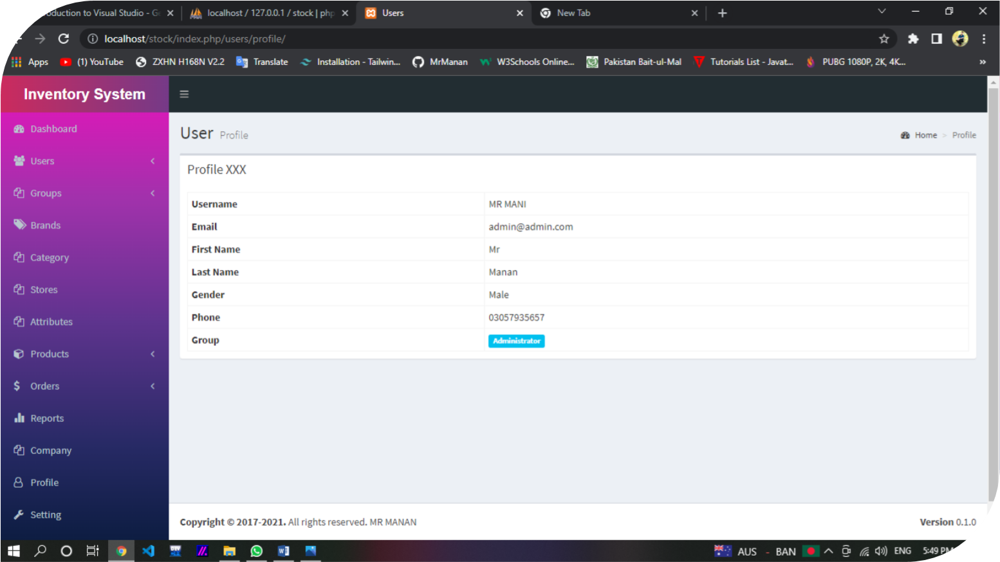
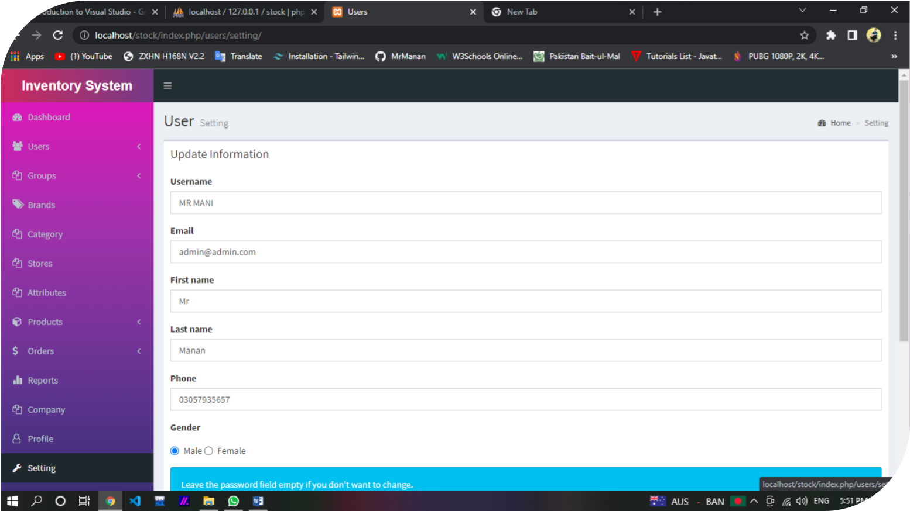

## Project Objectives

- Simplify inventory management processes
- Improve accuracy in product and stock records
- Organize business data using a relational database
- Provide an accessible administrative interface
- Apply web development and database concepts in a practical project

## Repository Information

This repository contains screenshots documenting the academic project.

**Note:** The original source code is not currently included in this repository.

## Developer

**Muhammad Mateen Rasool**

Associate Degree in Computer Science (ADP)  
Government College University Faisalabad  
CGPA: 3.21

### Connect With Me

[LinkedIn](https://www.linkedin.com/in/muhammad-mateen-rasool-3b2183451/)

[GitHub Profile](https://github.com/mateenray3-1)

---

**Project Type:** Academic Project  
**Category:** Web Development & Database Management
